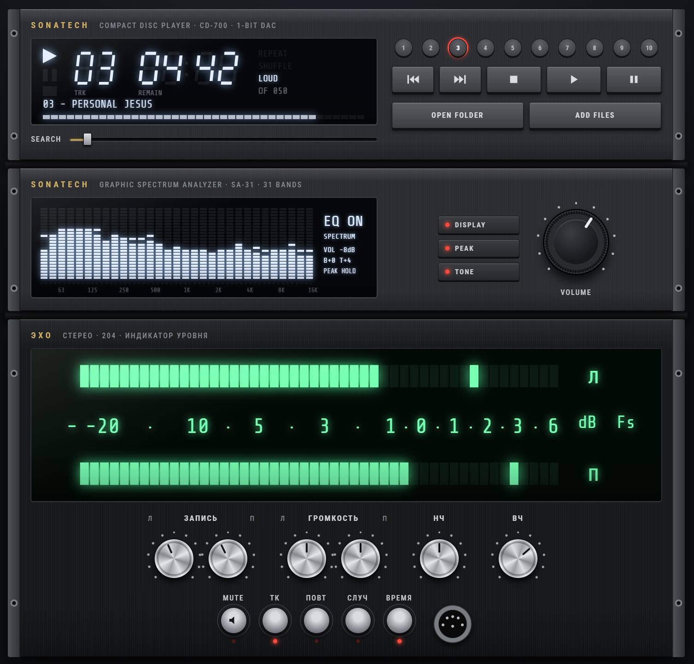

# Sonatech

## Hi-Fi Rack

A browser-based Hi-Fi rack emulator featuring three classic audio components, all running in a single HTML file with zero dependencies.

### Components

**CD Deck** — A backlit white-blue display with seven-segment track number and time, status icons, a scrolling title, and a level bar. Transport keys, 1–10 track buttons, and a search slider.

**Spectrum Analyzer** — A 31-band bar display with falling peak dots, plus a finer 62-band view and a dot-matrix scope. Features the big ridged volume knob and an "EQ ON" readout.

**Mayak-Style Deck** — Green glowing L/R level bars with the dB scale in the middle (−20 … 0 … +6), and Cyrillic labels from the original hardware. Knobs for ЗАПИСЬ (record level) and ГРОМКОСТЬ (volume) for L/R, plus НЧ (bass) and ВЧ (treble), with mute, loudness, repeat, shuffle, and remaining-time buttons.

### Usage

- **Open folder** — Pick a folder to play your own music
- **Drag & drop** — Drop files or a whole folder onto the page
- **Add files** — Appends to the current playlist
- **Play demo loop** — Built-in synth track so you can see the meters move without any music files

Files play straight from your disk — nothing is uploaded. Folder picking depends on your browser; iOS can't pick folders, so use Add files there.

### Technical Notes

Built with plain canvas for the displays instead of three.js, since flat LCD and VFD panels don't need 3D. A 3D rack with camera controls could be built next if there's interest.